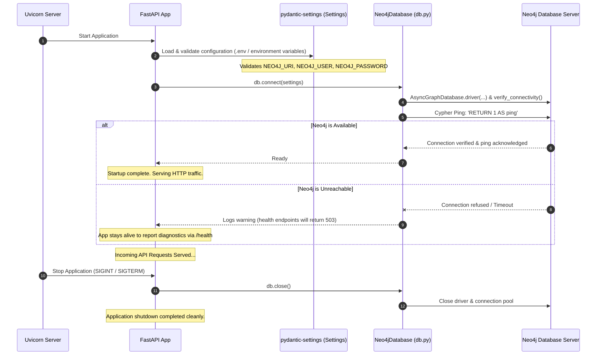
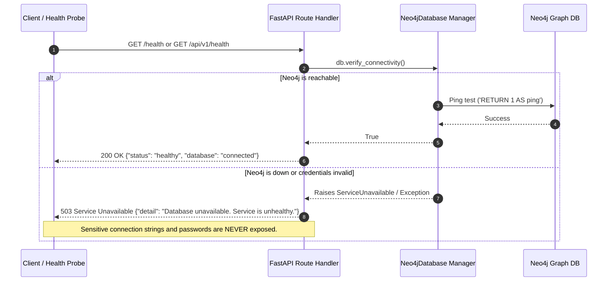

# Organ/Blood Donor–Recipient Matching Network — Phase 1 Workflow

## 1. Overview & Architecture

Phase 1 establishes the production-grade, asynchronous backend foundation for an Organ and Blood Donor–Recipient Matching Network. It bridges FastAPI with a Neo4j 5 graph database instance using the official asynchronous Neo4j driver.

```mermaid
graph TD
    Client["Client / Frontend (e.g. Vite: http://localhost:5173)"]
    FastAPI["FastAPI Application (Uvicorn / Asynchronous ASGI)"]
    Lifespan["FastAPI Lifespan Manager"]
    Driver["Neo4j AsyncDriver (Connection Pool)"]
    Neo4jDB["Neo4j 5 Graph Database (Bolt Protocol :7687)"]

    Client -->|HTTP GET / /health /api/v1/health| FastAPI
    Lifespan -->|1. Startup: connect() & verify_connectivity()| Driver
    Lifespan -->|2. Shutdown: close()| Driver
    FastAPI -->|Check Connectivity (Ping)| Driver
    Driver -->|Bolt Protocol| Neo4jDB
```

---

## 2. Application Startup & Lifespan Flow

When Uvicorn launches the FastAPI application, the lifespan context manager executes before incoming traffic is processed:



---

## 3. Request Flow: Health Check Endpoints

The system provides `/health` and `/api/v1/health` for monitoring tools, load balancers, and developers.



---

## 4. Process Health vs. Database Connectivity Check

Understanding the critical architectural distinction between these two health patterns:

| Aspect | Process Health Check (Liveness Probe) | Database Connectivity Check (Readiness Probe) |
| :--- | :--- | :--- |
| **Question Answered** | "Is the Python/Uvicorn HTTP server process alive and answering network sockets?" | "Can the application actually talk to Neo4j and execute database transactions?" |
| **Typical Endpoint** | `GET /` (or a dedicated `/live`) | `GET /health` or `GET /api/v1/health` |
| **What it tests** | Event loop responsiveness, basic web server state. | Network reachability, authentication credentials, database connection pool, Cypher execution. |
| **Failure Response** | TCP connection refused or 500 error if worker died. | HTTP `503 Service Unavailable` with clean diagnostic message. |
| **Action on Failure** | Orchestrator (e.g., Kubernetes / Docker) restarts the container. | Traffic is held off; requests are prevented from hitting broken database calls. |

---

## 5. Security & Isolation Considerations

1. **Localhost Binding**: Ports `7474` and `7687` in `docker-compose.yml` are bound exclusively to `127.0.0.1` (`127.0.0.1:7474:7474`, `127.0.0.1:7687:7687`). This prevents external machines or public networks from scanning or accessing the database.
2. **Credential Sanitization**: In the event of a connection error, raw Neo4j exception messages and connection strings are intercepted. The API returns a sanitized HTTP 503 response.
3. **Secret Decoupling**: Passwords and keys reside solely in `.env` (which is excluded from Git via `.gitignore`).
