# Phase 2 — Neo4j Graph Data Model & Schema Documentation

## 1. Overview & Objectives

In Phase 2, the **Organ/Blood Donor–Recipient Matching Network** establishes its core graph database layer in **Neo4j 5**.
Traditional relational databases struggle with multi-hop network relationships (e.g., matching a donor's blood type through compatibility rules to a recipient, while filtering by geographical proximity to registering hospitals). 

In Neo4j:
- Donors, Recipients, Hospitals, Blood Types, Users, Match Requests, and Allocations are modeled as **Nodes**.
- Direct medical and institutional associations are modeled as **Edges (Relationships)**.
- Indexes accelerate search queries, and Uniqueness Constraints enforce entity integrity.

---

## 2. Complete Workflow

The following diagram illustrates the Phase 2 initialization, constraint enforcement, deterministic data seeding, and multi-hop verification workflow:

```mermaid
flowchart TD
    Config["1. Configuration (.env)"] --> Driver["2. Neo4j Async Driver (db.py)"]
    Driver --> Schema["3. Apply Schema & Constraints (schema.cypher)"]
    
    subgraph Constraints_and_Indexes ["Constraints & Indexes (schema_repository.py)"]
        C1["Uniqueness: donor_id, recipient_id, hospital_id, blood_type"]
        C2["Uniqueness: match_id, allocation_id, user_id, username"]
        I1["Indexes: donor status, organ_type, blood_type"]
        I2["Indexes: recipient status, organ_needed, urgency_score, blood_type"]
        I3["Index: match_status"]
    end
    
    Schema --> Constraints_and_Indexes
    Constraints_and_Indexes --> SeedNodes["4. Deterministic Seed Nodes (scripts/seed.py)"]
    
    subgraph Nodes ["Graph Nodes (121 total)"]
        N1["8 BloodType nodes"]
        N2["6 Hospital nodes (WGS-84 Point coordinates)"]
        N3["4 User nodes (PBKDF2 salted password hashes)"]
        N4["50 Synthetic Donors (status, organ, location, version=0)"]
        N5["50 Synthetic Recipients (urgency 1-10, waitlist_since, organ)"]
        N6["2 Demonstration MatchRequests"]
        N7["1 Demonstration Allocation"]
    end
    
    SeedNodes --> Nodes
    Nodes --> SeedRels["5. Seed Relationships (190 total)"]
    
    subgraph Relationships ["Graph Relationships"]
        R1["(BloodType)-[:CAN_DONATE_TO]->(BloodType) (27 rules)"]
        R2["(Donor)-[:HAS_BLOOD_TYPE]->(BloodType) (50)"]
        R3["(Recipient)-[:HAS_BLOOD_TYPE]->(BloodType) (50)"]
        R4["(Recipient)-[:REGISTERED_AT]->(Hospital) (50)"]
        R5["(User)-[:WORKS_AT]->(Hospital) (4)"]
        R6["(Donor)-[:PROPOSED_IN]->(MatchRequest) (2)"]
        R7["(MatchRequest)-[:FOR_RECIPIENT]->(Recipient) (2)"]
        R8["(MatchRequest)-[:REQUESTED_BY]->(Hospital) (2)"]
        R9["(Donor)-[:ALLOCATED_IN]->(Allocation) (1)"]
        R10["(Allocation)-[:TO_RECIPIENT]->(Recipient) (1)"]
        R11["(Allocation)-[:CONFIRMED_BY]->(Hospital) (1)"]
    end
    
    SeedRels --> Relationships
    Relationships --> Verify["6. Graph Verification & Traversal Queries (scripts/verify_graph.py)"]
```



---

## 3. Node Definitions & Property Specifications

### 1. `Donor`
Represents an individual offering an organ or blood donation.
- `donor_id` *(String, Unique, Indexed)*: Deterministic business key (e.g., `"DNR-001"`).
- `name` *(String)*: Synthetic fictional full name.
- `blood_type` *(String, Indexed)*: Blood group (e.g., `"O-"`, `"A+"`).
- `organ_type` *(String, Indexed)*: `"Kidney"`, `"Liver"`, `"Heart"`, `"Lung"`, `"Pancreas"`, or `"Blood"`.
- `location` *(Point)*: Neo4j 2D WGS-84 coordinate point (`point({latitude: ..., longitude: ...})`).
- `status` *(String, Indexed)*: `"Available"`, `"Reserved"`, `"Allocated"`, or `"Expired"`.
- `registered_at` *(DateTime, UTC)*: Registration timestamp.
- `expiry_window_hours` *(Integer, Optional)*: Viability window (e.g., 24 hours for heart/lung, 48 hours for kidney/liver).
- `version` *(Integer)*: Optimistic locking concurrency control counter, initially `0`.

### 2. `Recipient`
Represents a patient in need of an organ transplant or blood transfusion.
- `recipient_id` *(String, Unique, Indexed)*: Deterministic business key (e.g., `"REC-001"`).
- `name` *(String)*: Synthetic fictional full name.
- `blood_type` *(String, Indexed)*: Blood group.
- `organ_needed` *(String, Indexed)*: Organ or tissue required.
- `urgency_score` *(Integer, Indexed)*: Clinical triage score from `1` (lowest) to `10` (critical/immediate).
- `location` *(Point)*: Patient location coordinates.
- `waitlist_since` *(DateTime, UTC)*: Date and time added to the matching queue.
- `status` *(String, Indexed)*: `"Waiting"` or `"Allocated"`.

### 3. `Hospital`
Represents a participating transplant center or regional trauma facility.
- `hospital_id` *(String, Unique, Indexed)*: Unique identifier (e.g., `"HOSP-001"`).
- `name` *(String)*: Medical center name.
- `location` *(Point)*: Geographic coordinates of the facility.

### 4. `BloodType`
Reference catalog node representing universal blood groups.
- `blood_type` *(String, Unique)*: `"O-"`, `"O+"`, `"A-"`, `"A+"`, `"B-"`, `"B+"`, `"AB-"`, `"AB+"`.
- `category` *(String)*: `"Blood"`.

### 5. `MatchRequest`
Represents a candidate matching pair under clinical evaluation.
- `match_id` *(String, Unique, Indexed)*: Unique identifier (e.g., `"MTR-001"`).
- `match_score` *(Float)*: Computed matching compatibility score (e.g., `92.5`).
- `requested_at` *(DateTime, UTC)*: Timestamp when the match was generated.
- `status` *(String, Indexed)*: `"Pending"`, `"Confirmed"`, `"Rejected"`, or `"Expired"`.

### 6. `Allocation`
Represents a finalized, confirmed medical allocation of a donor to a recipient.
- `allocation_id` *(String, Unique, Indexed)*: Unique identifier (e.g., `"ALC-001"`).
- `confirmed_at` *(DateTime, UTC)*: Timestamp when the allocation was executed.

### 7. `User`
System staff with role-based access.
- `user_id` *(String, Unique)*: Identifier (e.g., `"USR-001"`).
- `username` *(String, Unique)*: System handle.
- `password_hash` *(String)*: Salted PBKDF2-HMAC-SHA256 hash (never plaintext).
- `role` *(String)*: `"ADMIN"`, `"COORDINATOR"`, `"DOCTOR"`, or `"AUDITOR"`.
- `is_active` *(Boolean)*: Account status flag.

---

## 4. Graph Relationships & Clinical Compatibility Nuance

```text
(Recipient)-[:REGISTERED_AT]->(Hospital)
(Donor)-[:HAS_BLOOD_TYPE]->(BloodType)
(Recipient)-[:HAS_BLOOD_TYPE]->(BloodType)
(BloodType)-[:CAN_DONATE_TO]->(BloodType)
(Donor)-[:PROPOSED_IN]->(MatchRequest)
(MatchRequest)-[:FOR_RECIPIENT]->(Recipient)
(MatchRequest)-[:REQUESTED_BY]->(Hospital)
(Donor)-[:ALLOCATED_IN]->(Allocation)
(Allocation)-[:TO_RECIPIENT]->(Recipient)
(Allocation)-[:CONFIRMED_BY]->(Hospital)
(User)-[:WORKS_AT]->(Hospital)
```

### Important Clinical Compatibility Notice
> [!IMPORTANT]
> **Blood Compatibility vs. Organ Transplant Compatibility:**  
> The `(BloodType)-[:CAN_DONATE_TO]->(BloodType)` relationship models standard red blood cell compatibility (e.g., O- is a universal donor; AB+ is a universal recipient).  
> **ABO compatibility is a prerequisite for organ transplantation, but it is NOT clinically sufficient.** Real-world solid organ transplantation requires additional clinical validation:
> 1. **HLA Matching (Human Leukocyte Antigen)**: Tissue typing across HLA-A, HLA-B, and HLA-DR loci to prevent acute rejection.
> 2. **Crossmatching (CDC / Flow Cytometry)**: Testing recipient serum against donor lymphocytes to verify no pre-formed Donor-Specific Antibodies (DSA) exist.
> 3. **Size / Weight & Anatomical Matching**: Donor organ size must match recipient body cavity dimensions.
> The demonstration matching algorithm in this project illustrates graph traversal and scoring, but should never be misconstrued as clinical diagnostic software.

---

## 5. Uniqueness Constraints vs. Allocation Integrity

> [!WARNING]
> Uniqueness constraints on `allocation_id` guarantee that an allocation ID is not reused. However, **uniqueness constraints alone CANNOT prevent double-allocation anomalies** (e.g., a donor being allocated to two recipients simultaneously).
> Preventing double allocations requires **transaction-level optimistic locking** (using the `Donor.version` property) or explicit locking Cypher transactions (`MATCH (d:Donor WHERE d.status = 'Available') SET d.status = 'Allocated', d.version = d.version + 1`), which will be implemented in the Phase 4 transaction engine.

---

## 6. Representative Graph Traversal Queries

### Query 1: Find Compatible Available Donors for a Waiting Recipient
Finds all available donors whose blood type can donate to recipient `REC-001`, filtering by required organ type, and computing spatial geodesic distance to the recipient's hospital:

```cypher
MATCH (rec:Recipient {recipient_id: 'REC-001'})-[:HAS_BLOOD_TYPE]->(rec_bt:BloodType)
MATCH (donor_bt:BloodType)-[:CAN_DONATE_TO]->(rec_bt)
MATCH (donor:Donor {organ_type: rec.organ_needed, status: 'Available'})-[:HAS_BLOOD_TYPE]->(donor_bt)
MATCH (rec)-[:REGISTERED_AT]->(hosp:Hospital)
RETURN 
    rec.recipient_id AS recipient_id,
    rec.name AS recipient_name,
    rec.blood_type AS recipient_blood,
    rec.organ_needed AS organ_needed,
    hosp.name AS hospital,
    donor.donor_id AS donor_id,
    donor.name AS donor_name,
    donor.blood_type AS donor_blood,
    point.distance(donor.location, hosp.location) / 1000.0 AS distance_km
ORDER BY distance_km ASC
LIMIT 5;
```

### Query 2: Inspect Confirmed Allocations with Full Chain of Custody
Traverses the allocation graph to inspect the donor, recipient, and the confirming hospital:

```cypher
MATCH (d:Donor)-[:ALLOCATED_IN]->(alc:Allocation)-[:TO_RECIPIENT]->(r:Recipient)
MATCH (alc)-[:CONFIRMED_BY]->(h:Hospital)
RETURN 
    alc.allocation_id AS allocation_id,
    alc.confirmed_at AS confirmed_at,
    d.donor_id AS donor_id,
    d.name AS donor_name,
    r.recipient_id AS recipient_id,
    r.name AS recipient_name,
    h.name AS confirming_hospital;
```
