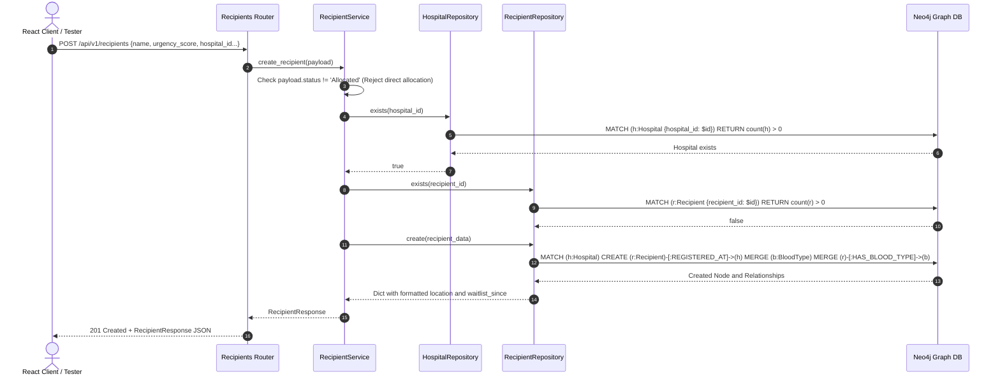
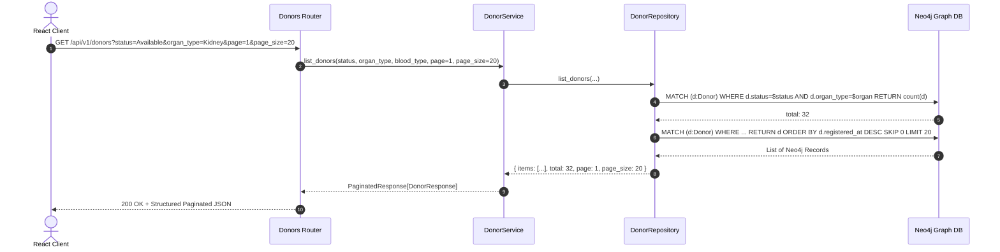
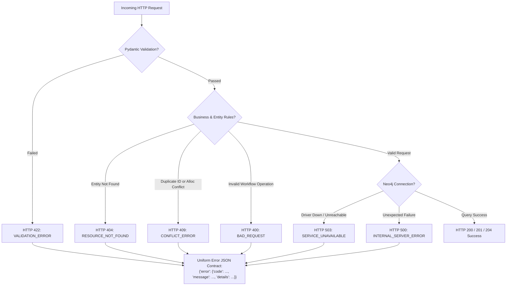

# Phase 3 — FastAPI CRUD APIs for Donors, Recipients, and Hospitals

This document provides a comprehensive report of Phase 3 implementation in the **Organ/Blood Donor–Recipient Matching Network**.

---

## 1. Summary of Implemented Endpoints

All CRUD operations are served under the `/api/v1` prefix using FastAPI and the native asynchronous Neo4j driver.

| Method | Endpoint | Description | Status Code | Error Codes |
|---|---|---|---|---|
| `POST` | `/api/v1/donors` | Create donor profile with Neo4j spatial point and blood type edge | `201 Created` | `409 DUPLICATE_DONOR_ID`, `422 VALIDATION_ERROR` |
| `GET` | `/api/v1/donors` | List donors with pagination and status/organ/blood filters | `200 OK` | `422 VALIDATION_ERROR` |
| `GET` | `/api/v1/donors/{donor_id}` | Retrieve individual donor by ID | `200 OK` | `404 DONOR_NOT_FOUND` |
| `PATCH` | `/api/v1/donors/{donor_id}` | Update donor details (auto-increments `version`) | `200 OK` | `404 DONOR_NOT_FOUND`, `422 VALIDATION_ERROR` |
| `DELETE` | `/api/v1/donors/{donor_id}` | Delete donor (protected against allocation history) | `204 No Content` | `404 DONOR_NOT_FOUND`, `409 DONOR_ALLOCATION_CONFLICT` |
| `POST` | `/api/v1/recipients` | Create recipient, verifies hospital exists, links blood type | `201 Created` | `400 INVALID_INITIAL_STATUS`, `404 HOSPITAL_NOT_FOUND`, `409 DUPLICATE_RECIPIENT_ID` |
| `GET` | `/api/v1/recipients` | List recipients with pagination and filters | `200 OK` | `422 VALIDATION_ERROR` |
| `GET` | `/api/v1/recipients/{recipient_id}` | Retrieve recipient profile by ID | `200 OK` | `404 RECIPIENT_NOT_FOUND` |
| `PATCH` | `/api/v1/recipients/{recipient_id}` | Update recipient details without dropping relationships | `200 OK` | `404 RECIPIENT_NOT_FOUND`, `404 HOSPITAL_NOT_FOUND` |
| `PATCH` | `/api/v1/recipients/{recipient_id}/urgency` | Dedicated clinical urgency score (1-10) updater | `200 OK` | `404 RECIPIENT_NOT_FOUND`, `422 VALIDATION_ERROR` |
| `DELETE` | `/api/v1/recipients/{recipient_id}` | Delete recipient (protected against allocation history) | `204 No Content` | `404 RECIPIENT_NOT_FOUND`, `409 RECIPIENT_ALLOCATION_CONFLICT` |
| `POST` | `/api/v1/hospitals` | Create hospital with geographic coordinates | `201 Created` | `409 DUPLICATE_HOSPITAL_ID`, `422 VALIDATION_ERROR` |
| `GET` | `/api/v1/hospitals` | List hospitals with pagination and name substring search | `200 OK` | `422 VALIDATION_ERROR` |
| `GET` | `/api/v1/hospitals/{hospital_id}` | Retrieve hospital details | `200 OK` | `404 HOSPITAL_NOT_FOUND` |
| `PATCH` | `/api/v1/hospitals/{hospital_id}` | Partially update hospital properties | `200 OK` | `404 HOSPITAL_NOT_FOUND` |
| `DELETE` | `/api/v1/hospitals/{hospital_id}` | Delete hospital (protected against active relationships) | `204 No Content` | `404 HOSPITAL_NOT_FOUND`, `409 HOSPITAL_CONFLICT` |

---

## 2. Request-to-Database Workflow Architecture

```
HTTP Request (Client)
        │
        ▼
   [FastAPI Router]          <── Layer 1: HTTP routing, param parsing, status codes
        │
        ▼
  [Pydantic Validation]      <── Layer 2: Type checking, coordinate bounds, enum validation
        │
        ▼
   [Service Layer]           <── Layer 3: Business rules, ID generation, integrity constraints
        │
        ▼
  [Repository Layer]         <── Layer 4: Parameterized Cypher execution & session lifecycle
        │
        ▼
 [Neo4j Graph Database]      <── Layer 5: Constraints, nodes, relationships, spatial indexes
```

### Separation of Concerns:
1. **Routers (`app/routers/`)**: Pure HTTP handlers. Maps requests, queries, path parameters to service methods and selects response status codes. Never runs Cypher queries.
2. **Schemas (`app/schemas/`)**: Strict Pydantic v2 schemas. Validates coordinate ranges (`latitude [-90, 90]`, `longitude [-180, 180]`), enum memberships, and urgency bounds (`1-10`). Distinguishes unset fields during PATCH via `exclude_unset=True`.
3. **Services (`app/services/`)**: Business logic and orchestrations. Enforces that referenced hospitals exist, duplicate IDs are rejected, deletion is prevented when allocation history exists, and donor versions are incremented automatically.
4. **Repositories (`app/repositories/`)**: Native parameterized Cypher queries. Converts Neo4j `Point` and `DateTime` objects into standard JSON-compliant primitives. Manages transactions and relationship traversals without Cartesian duplicates.
5. **Core (`app/core/`)**: Configuration settings via `pydantic-settings`, global async Neo4j driver connection lifecycle, and domain exception definitions.

---

## 3. Workflow Mermaid Diagrams

### A. Create Donor Flow
```mermaid
sequenceDiagram
    autonumber
    actor Client as React Client / Tester
    participant Router as Donors Router
    participant Schema as Pydantic (DonorCreate)
    participant Service as DonorService
    participant Repo as DonorRepository
    participant DB as Neo4j Graph DB

    Client->>Router: POST /api/v1/donors {name, blood_type, organ_type, location...}
    Router->>Schema: Validate body, bounds & enums
    Schema-->>Router: Validated DonorCreate payload
    Router->>Service: create_donor(payload)
    Service->>Repo: exists(donor_id)
    Repo->>DB: MATCH (d:Donor {donor_id: $id}) RETURN count(d) > 0
    DB-->>Repo: false
    Repo-->>Service: false (not exists)
    Note over Service: Generate UUID if ID omitted; set registered_at & version=0
    Service->>Repo: create(donor_data)
    Repo->>DB: CREATE (d:Donor) ... MERGE (b:BloodType) MERGE (d)-[:HAS_BLOOD_TYPE]->(b)
    DB-->>Repo: Created Node & point({latitude, longitude})
    Repo-->>Service: Dict with ISO timestamps and location
    Service-->>Router: DonorResponse
    Router-->>Client: 201 Created + DonorResponse JSON
```

### B. Create Recipient Flow


### C. Retrieve Donors Flow (Filtered & Paginated)


### D. Error Handling Flow


---

## 4. Final Directory Tree

```
OrganLink/
├── .env
├── .env.example
├── docker-compose.yml
├── docs/
│   ├── api-contract.md
│   ├── openapi.json
│   ├── phase-1-workflow.md
│   ├── phase-2-data-model.md
│   └── phase-3-workflow.md
└── backend/
    ├── requirements.txt
    ├── pytest.ini
    ├── app/
    │   ├── main.py
    │   ├── core/
    │   │   ├── config.py
    │   │   ├── db.py
    │   │   └── exceptions.py
    │   ├── repositories/
    │   │   ├── donor_repository.py
    │   │   ├── hospital_repository.py
    │   │   ├── recipient_repository.py
    │   │   └── schema_repository.py
    │   ├── routers/
    │   │   ├── donors.py
    │   │   ├── hospitals.py
    │   │   └── recipients.py
    │   ├── schemas/
    │   │   ├── common.py
    │   │   ├── donor.py
    │   │   ├── enums.py
    │   │   ├── hospital.py
    │   │   └── recipient.py
    │   └── services/
    │       ├── donor_service.py
    │       ├── hospital_service.py
    │       └── recipient_service.py
    ├── cypher/
    │   ├── constraints.cypher
    │   ├── indexes.cypher
    │   └── seed.cypher
    ├── scripts/
    │   ├── export_openapi.py
    │   └── seed.py
    └── tests/
        ├── test_crud_integration.py
        ├── test_crud_unit.py
        ├── test_graph.py
        └── test_health.py
```

---

## 5. Example Requests and Responses

### Example 1: Create Donor (`POST /api/v1/donors`)
**Request:**
```bash
curl -X POST http://localhost:8000/api/v1/donors \
  -H "Content-Type: application/json" \
  -d '{
    "donor_id": "DNR-099",
    "name": "Maria Garcia",
    "blood_type": "O-",
    "organ_type": "Kidney",
    "location": {"latitude": 13.0827, "longitude": 80.2707},
    "status": "Available",
    "expiry_window_hours": 36
  }'
```
**Response (`201 Created`):**
```json
{
  "donor_id": "DNR-099",
  "name": "Maria Garcia",
  "blood_type": "O-",
  "organ_type": "Kidney",
  "location": {
    "latitude": 13.0827,
    "longitude": 80.2707
  },
  "status": "Available",
  "registered_at": "2026-10-15T17:55:00Z",
  "expiry_window_hours": 36,
  "version": 0
}
```

### Example 2: Update Recipient Urgency (`PATCH /api/v1/recipients/REC-001/urgency`)
**Request:**
```bash
curl -X PATCH http://localhost:8000/api/v1/recipients/REC-001/urgency \
  -H "Content-Type: application/json" \
  -d '{"urgency_score": 10}'
```
**Response (`200 OK`):**
```json
{
  "recipient_id": "REC-001",
  "name": "Kavita Rao",
  "blood_type": "A-",
  "organ_needed": "Kidney",
  "urgency_score": 10,
  "location": {
    "latitude": 14.7,
    "longitude": 78.3
  },
  "waitlist_since": "2024-05-10T14:40:00Z",
  "status": "Waiting",
  "hospital_id": "HOSP-001"
}
```

### Example 3: Deletion Conflict Error (`DELETE /api/v1/donors/DNR-004`)
**Response (`409 Conflict`):**
```json
{
  "error": {
    "code": "DONOR_ALLOCATION_CONFLICT",
    "message": "Cannot delete donor 'DNR-004': involved in 2 historical allocation/match record(s).",
    "details": null
  }
}
```

---

## 6. Tests and Actual Execution Outcomes

Execution command: `pytest -v` from `backend/`:
```
platform win32 -- Python 3.12.10, pytest-8.4.2
============================= 23 passed in 14.96s =============================
```

### Test Suite Breakdown:
- **`tests/test_crud_unit.py`** (13 passed):
  - `test_create_donor_success`: Validates donor creation schema and coordinates.
  - `test_create_donor_duplicate_id_409`: Verifies duplicate ID conflict response.
  - `test_get_donor_not_found_404`: Verifies standardized 404 response.
  - `test_patch_donor_semantics`: Verifies partial field updates and version increment.
  - `test_donor_filters_and_pagination`: Verifies query parameters and paginated format.
  - `test_delete_donor_with_allocation_history_409`: Confirms protected deletion rules.
  - `test_create_recipient_success`: Verifies hospital relationship and blood type binding.
  - `test_create_recipient_invalid_urgency_score_422`: Checks urgency validation outside 1-10.
  - `test_create_recipient_unknown_hospital_404`: Validates referenced hospital existence.
  - `test_update_recipient_urgency_endpoint`: Validates dedicated `/urgency` endpoint.
  - `test_create_hospital_success`: Verifies hospital creation and coordinates.
  - `test_get_hospital_by_id`: Verifies hospital retrieval.
  - `test_delete_hospital_conflicts_409`: Verifies hospital dependency protection.
- **`tests/test_crud_integration.py`** (3 passed against live Neo4j):
  - `test_live_hospital_crud_flow`: Complete live lifecycle (create, duplicate conflict, patch, delete, verify 404).
  - `test_live_donor_crud_and_conflict`: Live donor lifecycle, duplicate prevention, version bump, and allocation deletion conflict on seeded record `DNR-004`.
  - `test_live_recipient_crud_and_urgency`: Live recipient lifecycle, dedicated urgency patch, and allocation deletion conflict on seeded record `REC-004`.
- **`tests/test_graph.py`** (2 passed):
  - Live constraints and indexes verification.
  - Live seed counts verification (50 donors, 50 recipients, 6 hospitals, 8 blood types, 4 users, 27 compatibility edges).
- **`tests/test_health.py`** (5 passed):
  - Root endpoint, healthy mock, unhealthy mock (503), lifespan driver startup/teardown, live Neo4j ping.

---

## 7. Known Limitations

1. **Unauthenticated Endpoints**: As specified in the Phase 3 boundary requirements, endpoints do not yet check JWT bearer tokens or role-based permissions (ADMIN, COORDINATOR, DOCTOR, AUDITOR).
2. **No Ranking / Matching Execution**: Compatibility scoring, geographic radius filtering, and bipartite matching graphs are deferred to Phase 4.
3. **No Direct State Transition to `Allocated`**: Recipient and Donor statuses cannot be manually set to `Allocated` via CRUD PATCH, as that requires an allocation transaction.

---

## 8. Frontend Teammate Integration Guide

1. **Base URL**: `http://localhost:8000/api/v1`
2. **Interactive Documentation**: `http://localhost:8000/docs` (Swagger UI) or `http://localhost:8000/redoc`
3. **OpenAPI JSON**: Available at `docs/openapi.json` or live at `http://localhost:8000/openapi.json`
4. **TypeScript Definitions**: Directly copy the TypeScript types provided in `docs/api-contract.md` into your React frontend project (e.g. `src/types/api.ts`).
5. **CORS**: Preconfigured to allow `http://localhost:5173` (Vite) with full credential support.

---

## 9. Phase 3 Acceptance Checklist

- [x] Layered architecture established (`routers/`, `schemas/`, `repositories/`, `services/`, `core/`).
- [x] Donor CRUD endpoints implemented with coordinates, blood type relationship, auto-incrementing version, and allocation protection.
- [x] Recipient CRUD endpoints implemented with 1-10 urgency score, hospital existence verification, and dedicated `/urgency` endpoint.
- [x] Hospital CRUD endpoints implemented with coordinate validation, name search, and dependent relationship protection.
- [x] Standard error response contract (`{"error": {"code": ..., "message": ..., "details": ...}}`) enforced globally.
- [x] Standard paginated response contract (`items`, `total`, `page`, `page_size`) implemented for all lists.
- [x] Parameterized Cypher queries used exclusively with zero ORM overhead.
- [x] Unit test suite and live Neo4j integration test suite passing (23/23 tests pass).
- [x] `docs/openapi.json` generated from running FastAPI application.
- [x] `docs/api-contract.md` and `docs/phase-3-workflow.md` generated with diagrams and contracts.

---

## 10. Exact Next Steps for Phase 4

1. **Authentication & RBAC**: Implement JWT authentication using the seeded PBKDF2 user credentials and assign route guards based on user roles (`ADMIN`, `COORDINATOR`, `DOCTOR`, `AUDITOR`).
2. **Graph Matching Engine**: Implement Cypher queries traversing `(:Donor)-[:HAS_BLOOD_TYPE]->()-[:CAN_DONATE_TO]->()<-[:HAS_BLOOD_TYPE]-(:Recipient)` combined with spatial distance calculations (`point.distance`).
3. **Multi-Factor Priority Scoring**: Build a ranking algorithm incorporating blood compatibility, medical urgency score, organ viability expiry window, and transit distance.
4. **Transactional Allocation Workflow**: Implement state transitions from `Available`/`Waiting` to `Allocated` inside ACID transactions linking `MatchRequest` and `Allocation` nodes.
